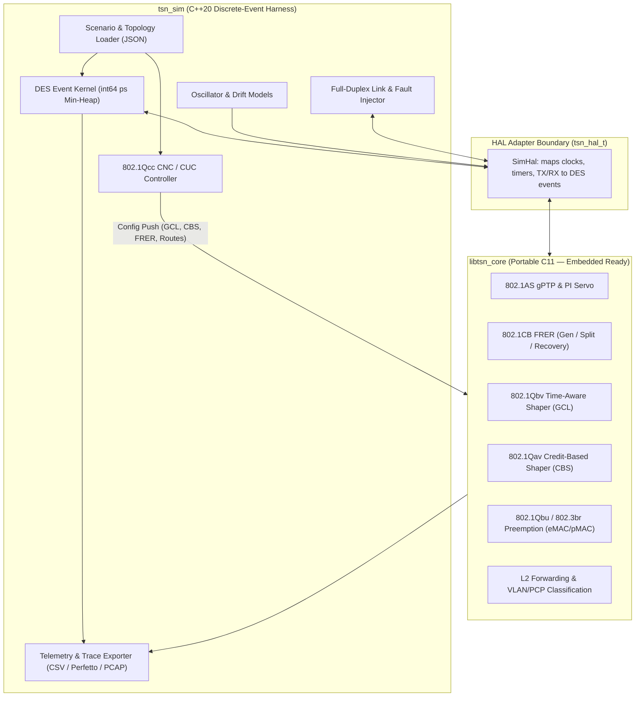

# rtt-open-tsn Simulator — Architecture & Design Specification

## 1. Design Philosophy & Goals

`rtt-open-tsn` (Real-Time TSN) aims to provide an open, real-time Time-Sensitive Networking (TSN) solution. Designing the simulator first establishes a deterministic verification environment before targeting real-time hardware (e.g., RTOS / bare-metal MCUs / FPGA-assisted NICs).

To avoid rewriting protocol logic twice, the architecture strictly separates **portable protocol/shaper logic** from the **simulation harness**:

1. **Portable TSN Core (`libtsn_core`, pure C11)**:
   - Implements TSN state machines, shapers, frame encoding/decoding, and config data structures.
   - Zero dynamic heap allocation on the packet hot path (fixed-size pools/ring buffers).
   - Interacts with clocks, timers, and MAC TX/RX solely through a thin HAL interface (`tsn_hal_t`).
   - Compiles cleanly both on host (linked into the simulator) and on real-time embedded / RTOS targets.
2. **Discrete-Event Simulator (`tsn_sim`, C++20)**:
   - Deterministic virtual-time event kernel with picosecond precision.
   - Physical channel models (link speed, propagation delay, clock drift, fault injection).
   - Topology & scenario loader (JSON), CNC/CUC simulation drivers, and rich telemetry exporters (CSV, JSON summary, Perfetto/Chrome Trace Gantt charts, PCAPNG).

---

## 2. High-Level System Architecture



### Node Internal Data Path (TSN Bridge / End Station)

```mermaid
flowchart LR
    RX["Ingress PHY / Link"] --> REASM["802.3br pMAC/eMAC Reassembly"]
    REASM --> GPTP_RX["802.1AS Ingress Timestamp & Intercept"]
    GPTP_RX --> FRER_IN["802.1CB Stream ID & Sequence Recovery"]
    FRER_IN --> FWD["L2 Forwarding / VLAN Filter + Fabric Delay"]
    FWD --> FRER_OUT["802.1CB Sequence Gen & Stream Split"]
    FRER_OUT --> Q["8 Egress Queues (PCP 0..7)"]
    Q --> CBS["802.1Qav CBS (Class A/B Queues)"]
    CBS --> TAS["802.1Qbv TAS Gates & Guard Band"]
    TAS --> PREEMPT["802.1Qbu / 802.3br Express vs Preemptable Arbiter"]
    PREEMPT --> TX["Egress PHY / Link"]
```



---

## 3. Time Model & Discrete-Event Kernel

### 3.1 Simulation Time Representation
- **Global Simulation Time**: `int64_t` in **picoseconds (`ps`)**.
  - Why picoseconds? At 10 Gbps Ethernet, 1 byte serializes in `0.8 ns` (`800 ps`), and 1 bit in `100 ps`. Using integer picoseconds avoids floating-point accumulation drift while spanning up to ~106.7 simulated days (`2^63 - 1 ps`), far exceeding any TSN simulation window.
- **Deterministic Event Ordering**:
  - Events in the min-heap are ordered by `(timestamp_ps, priority, sequence_id)`.
  - Tie-breaking by `(priority, sequence_id)` guarantees bit-for-bit reproducible runs across platforms for a given RNG seed.

### 3.2 Local Oscillator & Clock Model
Each node owns an independent `LocalClock` driven by global simulation time $t_{\text{sim}}$:
- Parameters: initial phase offset $\theta_0$, static frequency drift $d$ (in ppb, e.g., $\pm 20\text{ ppm}$), optional bounded random-walk drift, and gPTP servo rate adjustment $r_{\text{servo}}$.
- Conversion functions `sim_to_local(t_sim)` and `local_to_sim(t_local)` allow the DES kernel to schedule local timers (such as Qbv GCL transitions and gPTP Sync intervals) accurately in global simulation time without tick-by-tick polling.

### 3.3 Portable HAL Interface (`tsn_hal_t`)
`libtsn_core` interacts with its host environment exclusively via function pointers:
```c
typedef struct tsn_hal {
    void     *ctx;
    int64_t (*get_time_ps)(void *ctx);                     // Local synchronized clock
    void    (*adjust_clock)(void *ctx, int64_t offset_ps, double rate_ppb);
    uint64_t (*schedule_timer)(void *ctx, int64_t target_local_ps, tsn_timer_cb cb, void *arg);
    void    (*cancel_timer)(void *ctx, uint64_t timer_id);
    int     (*tx_frame)(void *ctx, uint8_t port_id, tsn_frame_t *frame);
    void    (*emit_metric)(void *ctx, const tsn_metric_event_t *evt);
} tsn_hal_t;
```
On real-time embedded / RTOS targets later, `SimHal` is simply swapped for a platform HAL backed by hardware PTP timers and Ethernet DMA.

---

## 4. Frame & Physical Link Model

### 4.1 Frame Representation (`tsn_frame_t`)
- **Wire fields**: DMAC, SMAC, 802.1Q Tag (`TPID=0x8100`, PCP 3-bit, DEI 1-bit, VID 12-bit), optional 802.1CB R-TAG (`TPID=0xF1C1`, reserved, 16-bit `seq_num`), EtherType, payload byte length (64–1522B wire size + 8B preamble/SFD + 12B IFG).
- **802.3br mPacket metadata**: `smd_type` (`SMD-E`, `SMD-S0..3`, `SMD-C0..3`), `frag_count`, `is_final`, `fragment_len_bytes`.
- **Simulation metadata** (stripped on embedded builds via `#ifdef TSN_SIM`): `stream_id`, `frame_uid`, `gen_time_ps`, `ingress_time_ps`, `deadline_ps`, `hop_trace[]`.

### 4.2 Full-Duplex Link & Fault Model
- Configurable link rate (`100 Mbps`, `1 Gbps`, `2.5 Gbps`, `10 Gbps`), wire propagation delay (`delay_ps`), and PHY TX/RX latency.
- **Fault Injector**: Supports scheduled or stochastic events:
  - Link down / link up at exact timestamps (for testing 802.1CB failover).
  - Bit-error rate (BER) or deterministic frame drop rules (e.g., drop every $N$-th frame on port $P$).

---

## 5. IEEE 802.1 TSN Protocol Modules

### 5.1 IEEE 802.1AS — Generalized Precision Time Protocol (gPTP)
- **Grandmaster & Spanning Tree**: Supports static GM configuration and Best Master Clock Algorithm (BMCA) state machine.
- **Peer Delay Mechanism**: Exchanges `Pdelay_Req`, `Pdelay_Resp`, and `Pdelay_Resp_Follow_Up` with hardware-equivalent TX/RX timestamps (`t1..t4`) to compute mean link delay and `neighborRateRatio`.
- **Time Synchronization**: Propagates `Sync` and `Follow_Up` frames; bridges accumulate residence time (`t_egress - t_ingress`) scaled by rate ratio plus upstream link delay into `correctionField`.
- **Clock Servo**: Configurable PI controller adjusting local oscillator rate and phase; logs per-node synchronization error `|local_time - gm_time|` over time.

### 5.2 IEEE 802.1Qbv — Time-Aware Shaper (TAS)
- **8 Egress Queues** per port (mapped from VLAN PCP 0..7 via configurable priority regeneration / traffic class table).
- **Admin / Oper GCL State Machine**:
  - Supports `AdminGateStates`, `AdminControlList` (entries with `{gate_mask, duration_ps, op: SetGateStates | SetAndHoldMAC | SetAndReleaseMAC}`), `AdminBaseTime`, `AdminCycleTime`, `AdminCycleTimeExtension`, and `ConfigChange`.
  - Atomic swap from `Admin` to `Oper` at the next `ConfigChangeTime` cycle boundary.
- **Guard Band**:
  - Non-preemptive mode: checks `remaining_open_time_ps >= serialize_time(frame_len)` before transmitting; blocks if it would overrun the gate closing edge.
  - Preemptive mode (with 802.1Qbu): `SetAndHoldMAC` triggers preemption of any in-flight pMAC frame, shrinking the guard band to ~123 bytes (max non-preemptable fragment) instead of full MTU.
- **Event-Driven**: Only schedules a DES event at the next GCL entry boundary or transmission completion.

### 5.3 IEEE 802.1Qav — Credit-Based Shaper (CBS)
- Per-queue parameters: `idleSlope` (bps), `sendSlope` (`idleSlope - portTransmitRate`), `hiCredit`, `loCredit`, and current `credit` (tracked in fixed-point bits or `double` + last update timestamp).
- **Exact Event-Driven Credit Update**:
  - Credit is updated lazily on state transitions (frame enqueue, TX start, TX end, Qbv gate open/close).
  - When a queue has frames waiting, gate is open, and `credit < 0`, the simulator computes the exact timestamp `t_ready = now + ceil(-credit / idleSlope)` and schedules a single wakeup event — zero polling overhead.
- **802.1Qbv Interaction**: Follows IEEE 802.1Q-2018 §8.6.8.2 — credit freezes when the queue's Qbv gate is closed.

### 5.4 IEEE 802.1Qbu / 802.3br — Frame Preemption
- Per-port `framePreemptionStatusTable` classifying each of the 8 traffic classes as `Express` (eMAC) or `Preemptable` (pMAC).
- **TX Fragmentation Engine**:
  - Tracks active pMAC frame transmission progress. If an Express frame becomes eligible (gate open) while a pMAC frame is transmitting:
    - Verifies at least `64 * (1 + addFragSize)` bytes have been sent and at least `60` bytes remain before FCS.
    - Truncates the current mPacket with `mCRC` (4B) + IFG (12B), transmits the Express frame (`SMD-E`), then resumes the pMAC frame with `SMD-C` + 8B preamble.
- **RX Reassembly Engine**:
  - Reassembles `SMD-S` + `SMD-C*` fragments per port; validates fragment counter continuity and detects/drops corrupted or orphaned fragments.

### 5.5 IEEE 802.1CB — Frame Replication and Elimination for Reliability (FRER)
- **Stream Identification**: Null Stream ID `(DMAC, VID)` and Active Destination MAC/VLAN Stream ID.
- **Sequence Generation**: Assigns monotonic 16-bit sequence numbers and inserts the 6-byte R-TAG (`0xF1C1`).
- **Stream Splitting**: Duplicates tagged frames onto multiple egress ports / disjoint VLANs as configured by CNC.
- **Sequence Recovery**:
  - **Vector Recovery Algorithm**: Sliding window (`HistoryLength`, `RecovSeqSpace=65536`, `TakeNoSequence`, `ResetTimer`) eliminating duplicates and handling bounded out-of-order delivery.
  - **Match Recovery Algorithm**: Lightweight single-last-sequence check.
  - Exposes standard 802.1CB counters (`PassedPackets`, `DiscardedPackets`, `OutOfOrderPackets`, `RoguePackets`, `LostPackets`, `TaglessPackets`).

### 5.6 IEEE 802.1Qcc — Centralized Configuration (CNC / CUC) & Scheduling
- **CUC (Centralized User Configuration)**: Aggregates Talker/Listener stream specs (`period_ps`, `max_frame_bytes`, `max_latency_ps`, `pcp`, `redundancy_paths`, `earliest/latest_tx_offset`).
- **CNC (Centralized Network Configuration)**:
  - Maintains the global topology graph and port capabilities.
  - **Path Computation**: Shortest-path (Dijkstra) for normal streams; edge/node-disjoint paths (Suurballe / k-disjoint shortest paths) for 802.1CB streams.
  - **Pluggable GCL Scheduler Interface (`IGclScheduler`)**:
    - `ManualGclScheduler`: Loads explicit GCLs from scenario JSON.
    - `HeuristicGclScheduler` (built-in v1): Computes hyperperiod (`LCM` of scheduled stream periods) and assigns conflict-free no-wait / bounded-delay TX windows along each stream's path, generating per-port GCLs and CBS slopes automatically.
    - Designed so an external SMT/ILP solver (e.g., Z3 / OR-Tools) can be plugged in later via JSON or C++ interface.
  - **Dynamic Reconfiguration**: Supports adding/removing streams mid-simulation by pushing new `Admin` GCLs with synchronized `AdminBaseTime` across all switches.

---

## 6. Configuration, Telemetry & Visualization

### 6.1 Scenario Input Format (JSON)
A single JSON file (or modular topology + streams + schedule files) defines:
- `simulation`: duration, RNG seed, trace options.
- `nodes`: end stations and bridges (clock drift ppm, switch fabric latency, port speeds).
- `links`: endpoints, bandwidth, propagation delay, fault schedules.
- `streams`: Talker, Listener(s), traffic class (TT / AVB-A / AVB-B / BE), period, payload size, deadline, FRER flag.
- `qcc`: scheduler mode (`manual` or `auto_heuristic`), gPTP sync interval, preemption config.

### 6.2 Outputs & Visualization
| Output | Format | Purpose |
| :--- | :--- | :--- |
| **Summary Report** | JSON / Console | Per-stream min/avg/p99/max E2E latency, jitter, deadline misses, PDR, FRER stats, max gPTP sync error |
| **Time-Series Metrics** | CSV | Clock sync error vs. time, per-queue depth, CBS credit trace, link utilization |
| **Gantt / Timeline Trace** | **Perfetto / Chrome Trace JSON** | Interactive visual inspection of Qbv GCL windows, Express vs. Preempted fragments, and hop-by-hop frame timing |
| **Packet Capture** | PCAPNG (optional) | Inspect generated 802.1AS, 802.1Q, and 802.1CB R-TAG frames in Wireshark |

---

## 7. Proposed Repository Layout & Build System

- **Build System**: CMake (≥ 3.20)
- **Languages**: C11 for `core/`, C++20 for `sim/` and `tests/`
- **Dependencies**: Minimal — `nlohmann/json` (header-only, simulator only) and `GoogleTest` (via CMake `FetchContent`). Zero external dependencies in `core/`.

```text
rtt-open-tsn/
├── CMakeLists.txt
├── docs/
│   └── simulator-design.md          # Approved architecture spec
├── core/                            # Portable C11 TSN core (embedded ready)
│   ├── include/tsn/
│   │   ├── hal.h
│   │   ├── frame.h
│   │   ├── gptp.h                   # 802.1AS
│   │   ├── qbv.h                    # 802.1Qbv
│   │   ├── qav.h                    # 802.1Qav
│   │   ├── qbu.h                    # 802.1Qbu / 802.3br
│   │   ├── frer.h                   # 802.1CB
│   │   └── bridge.h                 # L2 switch + port pipeline
│   └── src/
├── sim/                             # C++20 Discrete-Event Simulator
│   ├── include/sim/
│   │   ├── kernel.hpp               # DES event loop & min-heap
│   │   ├── clock.hpp                # Oscillator & drift model
│   │   ├── link.hpp                 # Full-duplex link & fault injector
│   │   ├── node.hpp                 # EndStation & Bridge wrappers (SimHal)
│   │   ├── cnc.hpp                  # 802.1Qcc CNC/CUC & IGclScheduler
│   │   ├── config.hpp               # JSON scenario loader
│   │   └── telemetry.hpp            # CSV, JSON, Perfetto trace, PCAPNG
│   └── src/
│       └── main.cpp                 # CLI entry point (`tsn-sim`)
├── scenarios/                       # Example topologies (line, ring, automotive zonal)
└── tests/                           # Unit tests (core C11) & E2E integration tests
```

---

## 8. Phased Implementation Roadmap

1. **Phase 1 — Foundation & DES Kernel**
   - CMake setup, `libtsn_core` frame/HAL primitives, `tsn_sim` picosecond DES kernel, `LocalClock`, full-duplex `Link`, basic L2 `Bridge` + `EndStation`, JSON scenario loader, CSV/JSON/Perfetto telemetry.
2. **Phase 2 — Time Sync & Core Shapers (802.1AS + 802.1Qbv + 802.1Qav)**
   - gPTP Peer Delay, Sync/Follow_Up, PI clock servo.
   - Qbv GCL engine with Admin/Oper swap and guard band.
   - Event-driven CBS credit engine and Qbv credit-freeze interaction.
3. **Phase 3 — Frame Preemption (802.1Qbu / 802.3br)**
   - eMAC/pMAC TX fragmentation and RX reassembly state machines.
   - Qbv `SetAndHoldMAC` / `SetAndReleaseMAC` integration and guard-band reduction verification.
4. **Phase 4 — Seamless Redundancy (802.1CB FRER)**
   - Stream ID, sequence generation (R-TAG), stream splitting, Vector/Match sequence recovery, and link-cut fault injection tests.
5. **Phase 5 — Centralized Config & Scheduling (802.1Qcc)**
   - CUC/CNC model, disjoint path finder, `HeuristicGclScheduler`, and mid-simulation dynamic stream reconfiguration.
6. **Phase 6 — Verification & Benchmarks**
   - Analytical vs. simulated latency bound tests, multi-hop industrial ring & automotive zonal benchmark scenarios, and documentation.
